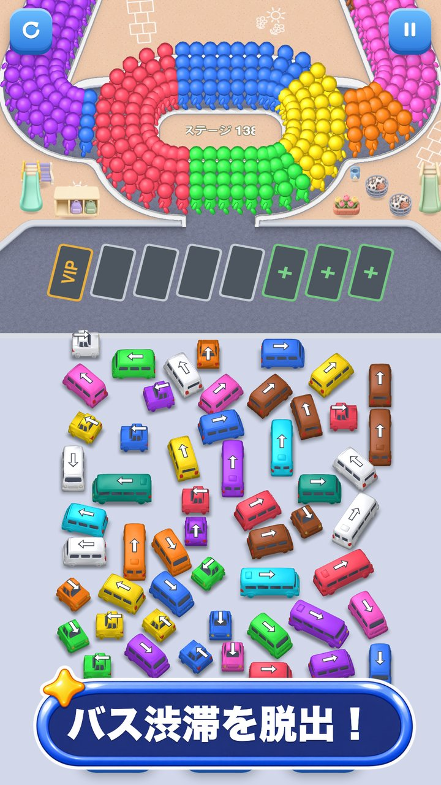

When Bus Loop Escape went live on Google Play on October 19, it spoke two languages: English and Korean. At 4:51 p.m. that day we decided to add Japanese and Traditional Chinese. By 10:53 p.m. we had built version 1.0.2 with five languages, Simplified Chinese included.

WaveWorks is a company where one founder decides what to make, and the code and art are built with Claude Code and Codex. Claude wrote the translation drafts too.

## Two languages on launch day

Our language plan from October 9 was to launch worldwide with English as the base language. There's no language menu in the game; it follows the phone's language setting. A Korean phone shows Korean, and every other phone shows English.

That meant someone using their phone in Japanese or Chinese got English screens. Simplified Chinese came in partway through the Japanese and Traditional Chinese work.

## Five hours of commits

Here's the commit log from that evening.

| Time | What went in |
|---|---|
| 17:17 | Japanese and Traditional Chinese game text and game names |
| 18:55 | Simplified Chinese |
| 21:10 | Draft Japanese and Chinese store copy |
| 21:21 | In-app products and screenshot scripts extended to the new languages |
| 22:38 | Japanese and Chinese screenshots composited |
| 22:53 | Version 1.0.2 |

Translating the game screens wasn't enough. Each language also needed its own store title, description, in-app product names and screenshots. We composited 72 screenshots for the new languages.

The game got a new name in each language: スクールバス大脱出 in Japanese, 校車大逃脫 in Traditional Chinese, 校车大逃脱 in Simplified Chinese. Each store title also names the genre, like "バス脱出パズル" (bus escape puzzle) in Japanese. Version 1.0.2 went public on October 23, and we entered the Japanese and Chinese store listings on October 25.

## Kanji in a Korean font

Once the translations were in, the Han characters in Japanese and Traditional Chinese showed up in Korean glyph shapes. Each language draws the same character a little differently, and the game was reaching for the Korean font first. We fixed it by putting Hiragino Sans ahead of the Korean font for Japanese, and PingFang TC for Traditional Chinese.

Chinese also needed a new rule for reading the phone's language. Before Simplified Chinese was in, we showed Simplified readers English so they wouldn't get Traditional characters. After it went in, Taiwan, Hong Kong and Macau settings, or any setting marked Traditional, get Traditional Chinese, and every other Chinese setting gets Simplified.

## Japanese product names that overflow

Translated text changes length. Three Japanese product names (上級, 達人 and 究極バンドル) and the titles of the attendance reward and gas station screens spilled out of their boxes, so we shortened them. The line break on the day 7 attendance tile got fixed when Simplified Chinese went in.

To keep this from happening again, we added a check. It opens each Japanese and Chinese screen in turn and confirms that no Korean characters remain and no text runs past its box.

## A different app name per language

Our next app, the baby log Oh My Baby, had five languages from the start. We had the option of translating the name word for word, but we went with names that add what the app does: オーマイベビー：赤ちゃん育児日記 in Japanese and Oh My Baby：宝宝成长记录 in Simplified Chinese.

"Oh My Baby" was already taken on the App Store, so English and Chinese use the full title with the description. Under the home screen icon, a Korean phone shows 오 마이 베이비 and any other phone shows Oh My Baby. We had Codex review the five-language text once more, which led to 64 fixes, and automated tests check that nothing overflows on a 360-pixel-wide screen.

## Translations still in draft

The Japanese and Chinese text in both apps is a draft that native speakers haven't reviewed yet. For Oh My Baby, we decided to get that review after launch. If something reads oddly, tell us through [Contact](/en/contact/) and we'll fix it.

More languages are coming. The company plan set on October 19 keeps these five as the base, then adds German, French, Spanish and Brazilian Portuguese, then Indonesian, for ten in total. Bus Loop Escape, which we're moving to Unity, already has a ten-language text table, and we shortened the "No ads" label where it overflowed in German, French, Spanish and Portuguese. Supporting a language and releasing in that country's store are separate decisions, and we're holding off on mainland China for now.
