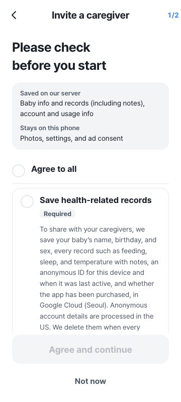

Oh My Baby is a baby log you can use with one hand during a night feed. We are testing it ahead of launch. On October 30 we added one new screen: a consent step. We started the design doc at 5:21 p.m. and had it live on the server by 8:44 p.m.

It's a small screen, but every path a baby's records take off the phone now runs through it. Here's how it got its current shape.

## Records stay on the phone by default

Everything you log in Oh My Baby is stored on that phone. Records reach our server in only two cases: when you share the log with a partner or another caregiver through an invite code, and when you sign in to turn on backup so your records survive a phone change.

Yet at those two moments the app asked almost nothing. A pre-launch review turned up these gaps:

- Health-related records (temperature, doctor visits, vaccines, stools, height and weight) went to the server without a separate question.
- The buttons didn't say what you were agreeing to.
- Nothing recorded who agreed, or when.
- Deleted records could stay on the server for up to a year, because cleanup only ran when some device opened the app.

Parents guard their baby's information more closely than anything else. We think that is where an app earns trust or loses it.

## First, when to ask

We compared three approaches. Asking for everything on first launch was the easiest, but it would push health consent on people who only keep records on their phone. Adding checkboxes to the existing share and backup screens was another option; the backup sheet would need scrolling, and the same explanation would live in two places.

We picked the third. One shared consent step appears only when records are about to leave the phone: when you start sharing, when you join through an invite, and when you turn on or restore a backup. If your records stay on your phone, you never see it.

## Show what goes where, then ask

The top of the screen splits "Saved on our server" from "Stays on this phone." Baby info and records go to the server; photos and settings stay on the phone. The card also says where we store the data (Google Cloud, Seoul) and when it gets deleted. Read first, then decide. Below that, each consent gets its own card:

- Storing health-related records
- Letting other caregivers view and edit records
- Confirming you are the baby's parent (legal guardian)

We drew three layouts, compared them, and went with one card per item. Nothing is pre-checked. For people who want to decide in one tap, a single "Agree to all" row sits at the top.

Only the person who creates the family space gets the parent question. Someone joining by invite might be a grandparent or a babysitter, and asking them to tap "I'm the parent" would push them into a false statement. We don't ask them.

## Saying no costs nothing

One rule held through the whole design: declining must not take away anything you already use on your phone. Tap [Not now] and sharing or backup doesn't start; your records stay where they are. The consent step also never cuts into one-tap logging.

Taking consent back is as easy as giving it. The existing [Stop sharing] and [Unlink and delete] buttons do that job, and they clear the consent record on the phone too.

## Every consent is recorded

We keep a record on both the phone and the server of which item someone agreed to, which wording they saw, and when. Only that person can write their server record, and the time comes from the server's clock. Nobody can delete a consent or roll it back to older wording.

Each item's wording has a version number. If the wording changes, the consent step shows again the next time the app opens, and you can still choose [Turn off sharing and backup] there.

We fixed deleted records as well. The server now runs a cleanup once a day and empties records deleted more than 30 days ago. We remove a deleted baby profile (name and birthday) entirely after 30 days. Records no longer sit on the server for a year because nobody opened the app.

## The final review caught three more

After building it all, we reviewed the whole flow again and found three problems:

1. A caregiver who joined by invite, turned on backup, and then ended sharing was asked the parent question again.
2. The [Turn off sharing and backup] button shown at launch logged people out instead of taking them to the stop-sharing screen.
3. The notice text didn't match what the app does: the items listed, the retention period, and the button names.

We fixed all three and matched the notice to the app's real behavior in all five supported languages. The retention line now says records are deleted when every caregiver stops sharing or no device is used for 1 year. After the fixes, all 2,625 app tests and 109 server tests passed.

## What's left

The Japanese and Chinese wording is still a draft that needs review by native speakers and a lawyer. The English health data policy page isn't written yet. Resending a consent record after the network comes back is next on the list.

We'll post here when Oh My Baby launches. Turn on sharing then, and this is the first screen you'll see.
