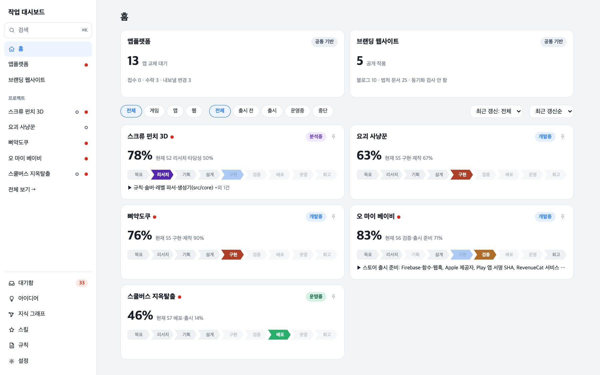
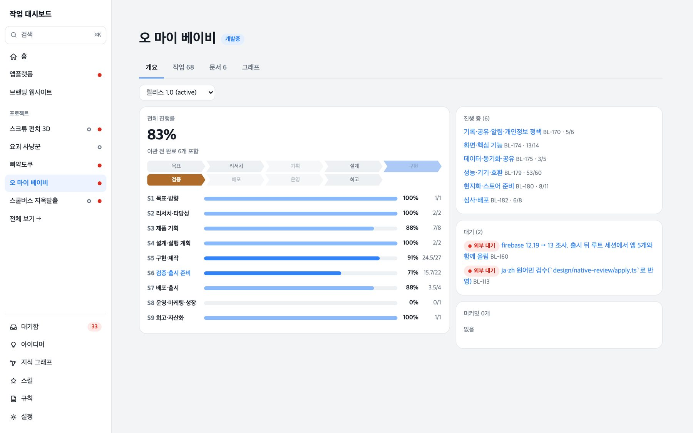
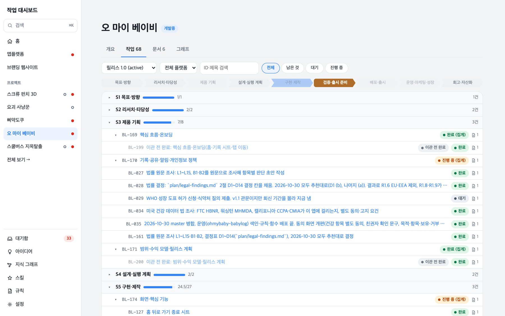
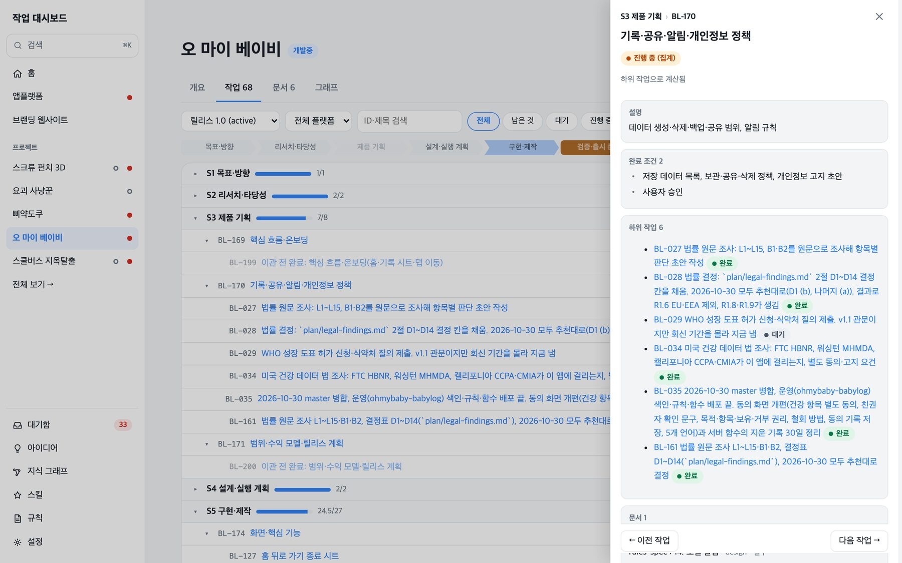

WaveWorks makes several mobile games and apps at the same time. We develop with Claude Code, an AI coding tool, and it has a limitation: when we open a new conversation (a session), it does not remember the previous one. Managing context well is essential. We have to leave documents that say where we stopped and what comes next, and once we reached five apps, that document-based approach stopped holding up.

So we replaced it. We moved the Markdown roadmap into a JSON file called `tasks.json`, and built a dashboard that reads this file and shows all five apps' progress.



Each project shows its progress and current work stage, so you can see how every project is doing at a glance.

## How we tracked work before

Take Oh My Baby, our baby-log app. It had two work documents.

- `docs/STATE.md` is the handoff document the next session reads first. It holds the current state and the next steps. Just before the switch it was 50 lines and 12,383 bytes.
- `docs/ROADMAP.md` is the list of remaining work: 224 lines and 39,731 bytes. Each stage has a table, and each row is one task.

```markdown
| 번호 | 할 일 | 담당 | 선행 | 완료 기준 | 근거 |
| R1.1 | [x] 법률 원문 조사: L1~L15, B1·B2를 원문으로 조사해 항목별 판단 초안 작성 | Claude | - | `plan/legal-findings.md`에 항목마다 출처·판단·방침 반영 여부·사용자 결정 칸 | SHARE-01 8.5.1, BACKUP-01 게시 관문 |
| R1.3 | [ ] WHO 성장 도표 허가 신청·식약처 질의 제출. v1.1 관문이지만 회신 기간을 몰라 지금 냄 | 사용자 | - | 접수 번호를 `plan/GAP-01-gates.md`에 적음 | GAP-01 |
| R10.1 | [ ] 성장 백분위 | Claude | R1.3 WHO 허가 | 기획서 관문 충족 … |
```

The table is in Korean, as we wrote it. Its columns are number, task, owner, prerequisite, done criteria, and evidence. R1.1 is legal research for the app, and R1.3 is an application for permission to use the WHO growth charts.

The number `R1.1` only shows order. Status is `[ ]` open, `[~]` partly done, `[x]` done. When every row of a stage reached `[x]`, we folded the stage into a one-line summary to keep the file under 400 lines. The evidence for finished work (console values, check dates) lived in other documents such as `plan/release-checklist.md`. The other apps were even less uniform. Three used a table-style progress file at `plan/progress.md`, and Bus Loop Escape used yet another format that someone had to copy over by hand.

## What was wrong

- The handoff document kept growing. We set a 12KB cap, but two apps' STATE.md files swelled to about 50KB, and every session has to read the whole thing.
- One task had two numbers. The roadmap called it `R1.3`; commit messages and records called it `GAP-01`. A person linked the two in the evidence column.
- A `[x]` carried no evidence. A checkbox records only that something is done. What we looked at is scattered across other documents, and there is no way to tell whether the code changed after the check.
- Prerequisites were sentences. In the table above, R10.1 lists `R1.3 WHO 허가` as its prerequisite. A person can read that; a program cannot work out which tasks are blocked.
- Every format needed its own reader before we could draw a screen. Only Oh My Baby's roadmap was converted one way into JSON for the dashboard, and that copy was not the original. Reading the table-style files too would have taken four parsers (programs that turn documents into data), and because numbers were assigned by order, they shifted whenever someone edited the document.

The goal was a single screen per project showing the current goal, progress, what is blocked, and what is waiting on a decision.

## Moving to a JSON file

We compared three options and chose A.

| Option | Original | Why not |
|---|---|---|
| A (chosen) | `tasks.json`. Handoff documents hold prose only; the roadmap is a read-only document generated from the file | — |
| B | Generate both the handoff document and the roadmap | We would have to rewrite the handoff rules and the wiki update procedure |
| C | Keep Markdown as the original and derive JSON with parsers | Needs four parsers. Order-based numbers shift with every edit. Writing means converting back to Markdown |

`ROADMAP.md` is now a document the program generates from `tasks.json`. Prose stays in STATE.md and the design documents, numbers and status live in the JSON, and a generated file never overwrites what a person wrote.

We split the work into five levels, from stage down to checklist item.

| Level | What it holds |
|---|---|
| Stage | `S1` to `S9`. Every app uses the same nine stages, from setting goals through release and operation to review |
| Epic | A large chunk of work inside one stage. Templates for each app type lay them out |
| Task | One piece of work that is built and checked. Progress is counted from this level |
| Subtask | Detail that appears while the work is under way |
| Checklist item | The smallest thing to check |

R1.3 above became the task below after conversion. The old number stays in `legacy`.

```json
{
  "id": "BL-029",
  "title": "WHO 성장 도표 허가 신청·식약처 질의 제출. v1.1 관문이지만 회신 기간을 몰라 지금 냄",
  "stage": 3,
  "parent": "BL-170",
  "release": "1.0",
  "status": "todo",
  "owner": "user",
  "legacy": [
    { "id": "R1.3", "kind": "roadmap", "source": "docs/legacy/ROADMAP-2026-11-05.md", "line": 37 },
    { "id": "GAP-01", "kind": "work-id", "source": "docs/legacy/ROADMAP-2026-11-05.md", "line": 37 }
  ],
  "done": [{ "text": "접수 번호를 `plan/GAP-01-gates.md`에 적음" }]
}
```

Prerequisites go in `dependsOn` as task IDs; 59 of Oh My Baby's 176 tasks use it. The checker rejects cycles, and waits that a person has to resolve, such as an external reply, go in a `block` field.

Completion and verification are handled separately. A task's `status: done` is a fact about the past, so we store it. Whether its verification is still valid, and the progress figure, are computed each time the file is read. That way an outdated check never erases the fact that the work was finished.

## When several sessions write at once

One person runs several AI sessions at the same time, so two sessions sometimes edit the same file. A request to change a status carries the value it read.

```json
{
  "taskId": "BL-029",
  "set": { "status": "doing" },
  "expect": { "status": "todo" },
  "baseHash": "…"
}
```

The server takes a lock (a device that lets only one writer in at a time) and rereads the latest file. For each field being set, it checks that `expect` equals the latest value. If all match, it applies the change even if other fields moved in the meantime. If any differ, it rejects the whole request and returns the latest values.

- Applied: while A writes `status` from `doing` to `done`, B changes only the same task's `block`. `status` still matches, so the write goes through.
- Rejected: B first changed `status` to `hold`. A's `expect.status = doing` no longer matches, so the write is refused and `hold` comes back.

Every changed field adds one line to `changes.jsonl` (165 lines for Oh My Baby). Only three fields can be written this way: `status`, `block`, and `verification`.

## Finding out that a finished check has gone stale

The weakness of a checkbox was that it never said what we had looked at. Now a "checked" record also stores the hash (sha256) of the files we checked. A hash squeezes a file's content into a short value that changes if even one character changes. Later we recompute it from the same files, and if it differs, the check is marked stale (`stale`).

| What was checked | How we compare it again |
|---|---|
| `path` (several files) | Recompute the files in the working tree. Deleting, adding, or editing any of them makes the check stale |
| `doc` (one section of a document) | Extract the section again and compare. A section that disappears also goes stale |
| `env` (an environment value) | Compare the string with the value in `project.json` |

Here is a real record. We tapped Oh My Baby's sleep-notification button on a physical phone, and recorded the two code files that build the notification as inputs.

```json
{
  "state": "passed",
  "method": "S23 실기기 화면 조작(adb)",
  "note": "2026-11-05 22:17~22:26 1.0(7): 수면 알림 [수면 끝내기] 탭 시 앱이 열려 수면 종료+수정 시트, 알림 사라짐 …",
  "inputs": [{
    "kind": "path",
    "refs": [
      "android/app/src/main/java/com/waveworks/babylog/RunningNotifications.kt",
      "android/app/src/main/java/com/waveworks/babylog/RunningDismiss.kt"
    ]
  }]
}
```

The `method` field says the check was done by operating a physical S23 phone over adb. The `note` says that during the check, build 1.0(7) opened the app from the [End sleep] notification button, ended the sleep, showed the edit sheet, and cleared the notification.

If either file changes, this check goes stale. Only the server code computes hashes, and it discards any hash a request sends. A `passed` record that declares no inputs cannot be judged, so it stays `unknown`.

`work check` validates the whole file with more than 30 rules. It catches dependency cycles, a parent marked done while its children are not, and a task marked done without a valid verification, and it exits with code 1 if someone edited a generated document by hand. We also set up hooks in the working environment. They block an edit to generated documents such as `ROADMAP.md` and to frozen originals the moment it is attempted, and they warn when someone edits `tasks.json` directly.

## Moving the old documents

We moved Oh My Baby first. We checked that all 132 old items map to new tasks and that the 29 items we exempted were still there. `work check` gave 0 errors and 47 warnings. We froze the original as `docs/legacy/ROADMAP-2026-11-05.md` and wrote its hash into `project.json`.

The three apps with table-style progress files went through a dry run on copies first. They became 83, 78, and 30 tasks, all with 0 errors. We ran both rollback paths (before and after commit) and confirmed that the original's hash matched, and a review comment led us to add one more hash check before deleting an original. The real conversions produced 104, 99, and 34 tasks. One app showed progress higher than reality right after the switch, because its remaining plan was not yet registered and only finished work was visible. We fixed it by registering the remaining plan.

We revised the epic templates once. The first version had 121 template epics, and only 47 had child tasks, so the screen filled with empty epics. No epic said where "done" ended, and existing apps had no way to follow a template change. The second version puts the completion criteria in the existing `done` field, folds empty epics by default, and leaves them out of progress. For an existing app, the tool creates epics under new IDs, moves the child tasks, deletes the old epic, and keeps the old ID in `legacy`. Running it again gives the same result, so a third version can be rolled out with the same command. We moved all five apps with one command, and 19 `check:apps` checks passed.

## The dashboard

We built the server with Node's `node:http` module, and the screens with Vite and React, kept inside the `work/dashboard` folder. The server watches the task file and refreshes the screen on change. If the file fails validation, it keeps showing the last good screen and adds a yellow banner on top. We saw that banner ourselves while capturing screenshots for this post: a server that had been running since before the change was reading the file with the old schema and showed only `should NOT have additional properties`. We started a new server on another port.

We drew three card designs for the home screen. The first version had three bars, a full epic list, and three chips, and it did not quickly answer "how far along are we, and what are we doing now." We picked the one with a large overall percentage and a single row of stage chips.



Opening a project shows the Overview tab with progress per stage (`S1` to `S9`), tasks in progress, tasks waiting, and changes not yet committed. Both waiting items are external. One waits for a native speaker's review; the other is research into Firebase versions, postponed until after launch.



The Tasks tab expands as a tree: epics under each stage, tasks under each epic. An epic shows a status computed from its children ("Done (aggregate)"), and the "Done before migration" tasks we created during conversion are marked separately. The number on the right is how many documents are linked to that task.



Clicking a task opens a panel on the right with its completion criteria, subtasks, and linked design documents in one place, with buttons for the previous and next task.

We opened editing only as far as needed. Status can be changed only on tasks that have no children, and epic and stage progress cannot be edited because they are computed from the children. Writes go through the same module as the command-line tool, because if the server had its own write code, the lock and conflict rules would exist twice. A document body is sent with the hash of the version it was loaded from; on save, a mismatch with the current value rejects the save and reloads the latest body. AI sessions do not use the lock, so this comparison is the only protection.

We also caused an accident while checking the screens. While clicking around in a browser, we pressed a status button on a real project and changed one Oh My Baby task (`BL-027`). We restored that file to its `HEAD` state and limited later checks to actions that do not touch status buttons. We also hit a problem where a hidden tab held a live connection and used up the browser's connection limit, and fixed it.

## Results and what is left

Here are the `work check` results for the five apps.

| App | Tasks | Errors | Warnings |
|---|---|---|---|
| Bus Loop Escape | 67 | 0 | 0 |
| Oh My Baby | 176 | 0 | 15 |
| Screw Punch 3D | 113 | 0 | 34 |
| CheepDoku | 108 | 0 | 33 |
| Yokai Hunters | 46 | 0 | 3 |
| Total | 510 | 0 | 85 |

Most warnings mean "marked done, but the verification record is missing or stale." For Oh My Baby, 14 of the 15 are `done-without-valid-verification`. We linked every remaining warning to a per-app check task, and most are items to check by hand on a physical phone.

The old ROADMAP.md (39,731 bytes) is now a generated document (230 lines, 29,097 bytes). According to the handoff notes, the automated tests number 615 for the dashboard and 604 for the `work` tool.

Some things are still not done.

- We have not shrunk the handoff document, which was the original problem. We now have a rule against copying the task list into STATE.md, but two apps' STATE.md files are still 50,093 and 49,733 bytes.
- We have not looked at some dashboard screens by eye: focus movement between the menu and the task panel below 900px wide, bottom pinning when the window is made shorter, and overlapping focus when the command palette opens while closing the menu.
- The server needs a restart to pick up code changes.
- The root repository's `npm run check` does not include `work/`, so we run it separately.
- There is no way to fold an empty epic again.

## How we work now

One work session goes like this.

```bash
# Open a session: get progress for the current release and tasks that are doing, ready, or blocked, as JSON
node work/bin/work.ts brief --dir docs/work

# If something unplanned comes up, register it when we start
node work/bin/work.ts add --dir docs/work --parent S5 --title "알림 버튼 재확인" --status doing

# When done, change the status, sending the value we read as expect
node work/bin/work.ts set <task ID> --dir docs/work --set '{"status":"done"}' --expect '{"status":"doing"}'

# Before committing, regenerate the generated documents and check
node work/bin/work.ts render --dir docs/work
node work/bin/work.ts check --dir docs/work
```

`brief` returns keys such as `doing`, `ready`, `blocked`, `standing`, `verification`, and `check`. For Oh My Baby, `blocked` lists the two external waits, and `standing` lists the post-launch standing epics (inquiries and errors, acquisition and metrics, return visits and feature improvements).

- A request that was not in the plan is registered with `work add` when we start it. When it is finished we close it with `work set`, and any design document or verification report we made for it is attached with `work doc-add`.
- Before a commit we run `work render` and `work check` (0 errors), and commit `docs/work` and the generated documents together.
- STATE.md holds only the prose for the next session. It points to tasks by task ID and does not copy the task list.
- A new app starts with `work init`, which lays out template epics across S1 to S9 for its type (app, game, web).

Next are the screens we have not looked at by eye. After the status-button accident, we will check them without touching real project data.
