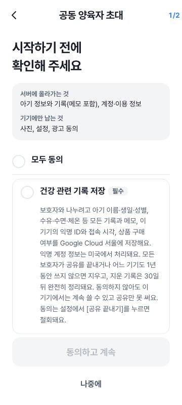

오 마이 베이비는 밤중 수유 중에도 한 손으로 기록하는 육아일지입니다. 지금은 출시를 앞두고 테스트 버전을 돌리고 있습니다. 10월 30일, 이 앱에 동의 화면 하나를 새로 넣었습니다. 오후 5시 21분에 설계서를 쓰기 시작해 밤 8시 44분에 실제 서버까지 반영했습니다.

작은 화면이지만 아기 기록이 휴대폰 밖으로 나가는 길은 이제 모두 이 화면을 지납니다. 어떤 고민 끝에 지금 모양이 됐는지 순서대로 적었습니다.

## 기록은 원래 휴대폰에만 남습니다

오 마이 베이비에 적은 기록은 기본으로 그 휴대폰에만 저장됩니다. 서버로 올라가는 경우는 두 가지뿐입니다. 배우자나 다른 보호자와 기록을 함께 보려고 초대 코드로 공유를 시작할 때, 그리고 휴대폰을 바꿔도 기록이 남도록 로그인해 백업을 켤 때입니다.

그런데 그 두 순간에 앱은 거의 아무것도 묻지 않았습니다. 출시 전에 점검해 보니 이런 구멍이 보였습니다.

- 체온, 병원, 접종, 대변, 키와 몸무게 같은 건강 관련 기록이 서버로 가는데 따로 묻지 않았습니다.
- 버튼만 봐서는 무엇에 동의하는지 알 수 없었습니다.
- 누가 언제 동의했는지 남기는 기록이 없었습니다.
- 지운 기록이 서버에 최대 1년까지 남을 수 있었습니다. 어느 기기에서도 앱을 열지 않으면 정리가 돌지 않았기 때문입니다.

아기 정보는 부모가 가장 예민하게 여기는 정보입니다. 앱이 믿을 만한지는 이런 데서 갈린다고 봤습니다.

## 언제 물을지부터 정했습니다

방법은 세 가지를 놓고 비교했습니다. 처음 앱을 켤 때 모든 동의를 한꺼번에 받는 방법이 가장 쉬웠습니다. 하지만 그러면 기록을 휴대폰에만 두고 쓰려는 사람까지 건강 정보 동의를 해야 합니다. 이미 있는 공유 화면과 백업 화면에 체크 칸을 하나씩 붙이는 방법도 있었는데, 백업 화면이 길어져 스크롤이 생기고 같은 설명이 두 군데로 나뉩니다.

그래서 세 번째 방법을 골랐습니다. 기록이 기기 밖으로 나가는 순간에만, 공통 동의 단계 하나를 띄웁니다. 공유를 시작할 때, 초대받아 참여할 때, 백업을 켜거나 복원할 때입니다. 기록을 휴대폰에만 두는 사람은 이 화면을 볼 일이 없습니다.

## 무엇이 어디로 가는지 먼저 보여 줍니다

화면 맨 위에는 "서버에 올라가는 것"과 "기기에만 남는 것"을 나눠 적었습니다. 아기 정보와 기록은 서버로 가고, 사진과 설정은 휴대폰에만 남습니다. 저장 위치(Google Cloud 서울)와 지우는 시점도 카드 안에 그대로 씁니다. 먼저 읽고, 그다음에 동의할지 정하면 됩니다. 그 아래에 동의 항목이 카드로 하나씩 나옵니다.

- 건강 관련 기록 저장
- 다른 보호자와 기록 보기·고치기
- 아기의 부모(법정대리인)인지 확인

화면 시안은 세 가지를 그려 놓고 비교한 뒤 항목별 카드 방식으로 정했습니다. 체크는 하나도 미리 걸어 두지 않습니다. 한 번에 고르고 싶은 사람을 위해 맨 위에 "모두 동의" 줄만 따로 뒀습니다.

부모 확인은 가족 공간을 처음 만드는 사람에게만 묻습니다. 초대받아 들어오는 사람은 할머니일 수도, 베이비시터일 수도 있습니다. 그 사람에게 "나는 부모입니다"를 누르게 하면 사실과 다른 체크를 강요하는 셈이라 묻지 않기로 했습니다.

## 거절해도 잃는 건 없습니다

설계하면서 끝까지 지킨 조건이 하나 있습니다. 동의하지 않아도 휴대폰 안에서 쓰던 기능은 하나도 줄지 않아야 한다는 것입니다. [나중에]를 누르면 공유나 백업만 시작되지 않고, 기존 기록은 그대로 남습니다. 동의 화면이 한 번에 기록하는 흐름을 끊고 들어오는 일도 없게 했습니다.

동의를 거두는 길도 같은 무게로 열어 뒀습니다. 이미 있던 [공유 끝내기]와 [연결 끊고 서버 기록 지우기] 버튼이 그 역할을 합니다. 누르면 휴대폰에 남은 동의 기록도 함께 지워집니다.

## 동의는 기록으로 남깁니다

누가 어떤 항목에, 어떤 문구를 보고, 언제 동의했는지를 휴대폰과 서버 양쪽에 남깁니다. 서버 쪽 기록은 본인만 쓸 수 있고, 시각은 서버 시계로 찍힙니다. 한 번 남긴 동의를 몰래 지우거나 예전 문구로 되돌릴 수는 없게 막았습니다.

안내 문구는 항목마다 판(버전)을 매깁니다. 나중에 문구가 바뀌면 다음에 앱을 켤 때 동의 단계가 다시 나옵니다. 여기서도 [공유·백업 끄기]를 고를 수 있습니다.

지운 기록도 손봤습니다. 이제는 서버가 매일 한 번 정리를 돌려, 지운 지 30일이 지난 기록의 내용을 비웁니다. 지운 아기 정보(이름, 생일)는 30일 뒤 통째로 삭제합니다. 앱을 다시 열지 않아도 1년씩 남는 일은 없어졌습니다.

## 마지막 점검에서 세 군데를 더 고쳤습니다

다 만든 뒤 전체를 다시 검토하다가 세 가지를 찾았습니다.

1. 초대받아 들어온 사람이 백업을 켰다가 공유를 끝내면 부모 확인을 다시 물었습니다.
2. 앱을 켤 때 나오는 [공유·백업 끄기]를 누르면 공유를 끝내는 화면 대신 로그아웃으로 넘어갔습니다.
3. 안내 문구에 적힌 항목, 보관 기간, 버튼 이름이 실제 동작과 조금씩 달랐습니다.

셋 다 고쳤고, 문구는 지원하는 다섯 언어 모두 실제 동작에 맞췄습니다. 지금 보관 기간 문구는 "모든 보호자가 공유를 끝내거나 어느 기기도 1년 동안 쓰지 않으면"입니다. 고친 뒤 앱 테스트 2,625개와 서버 테스트 109개가 모두 통과했습니다.

## 남은 일

일본어와 중국어 문구는 아직 초안이라 원어민 검토와 법률 검토를 받아야 합니다. 영어 건강 정보 정책 페이지도 아직 쓰지 못했습니다. 네트워크가 끊겼다 돌아왔을 때 동의 기록을 다시 보내는 기능도 다음 차례로 남겨 뒀습니다.

오 마이 베이비가 나오면 이 블로그에 소식을 올리겠습니다. 그때 공유를 켜 보시면 이 화면을 처음 만나게 됩니다.
