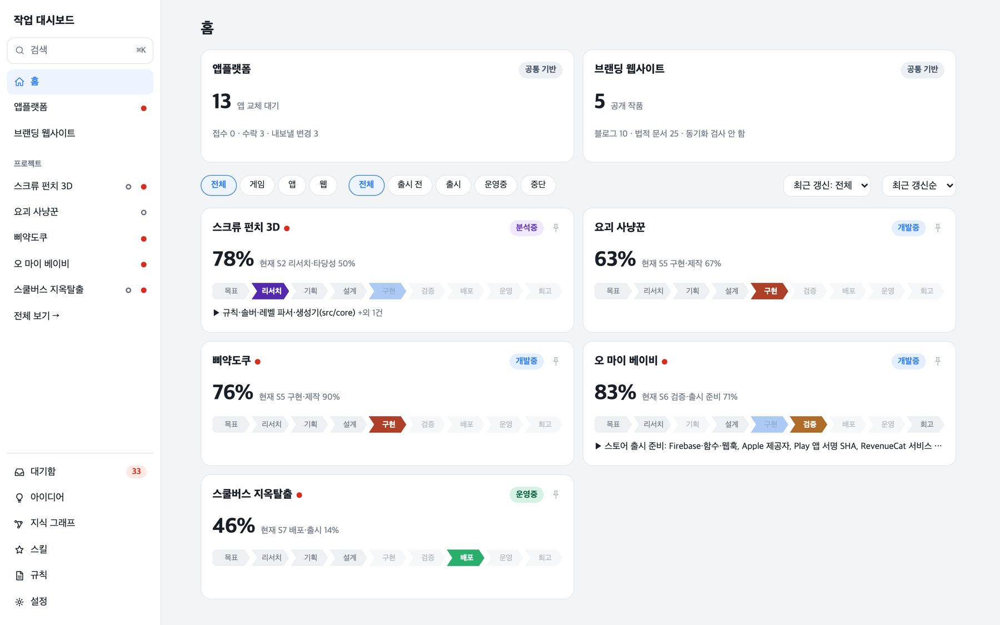
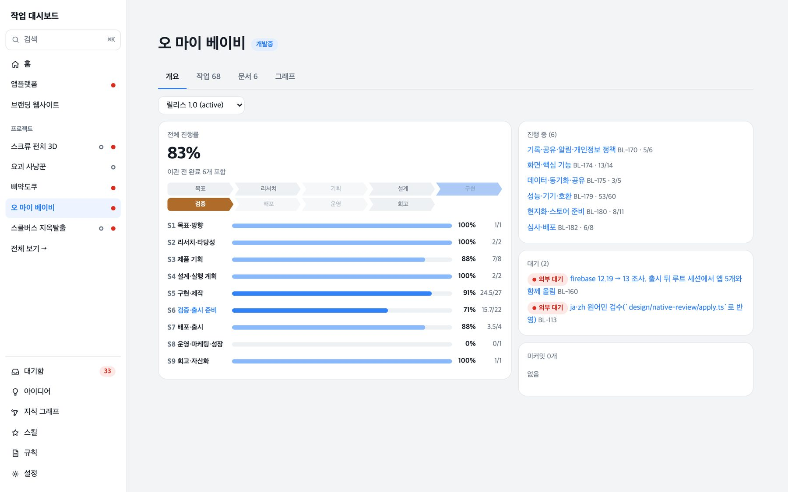
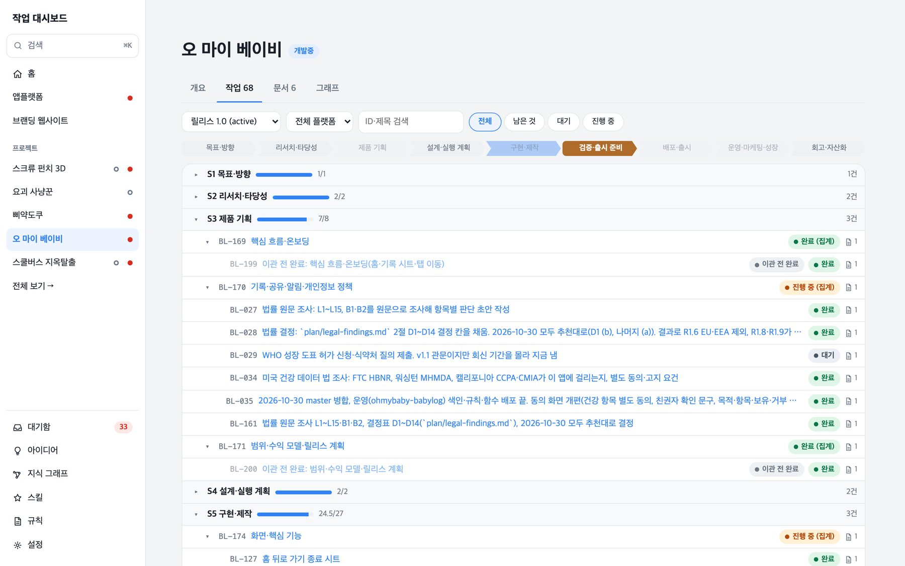
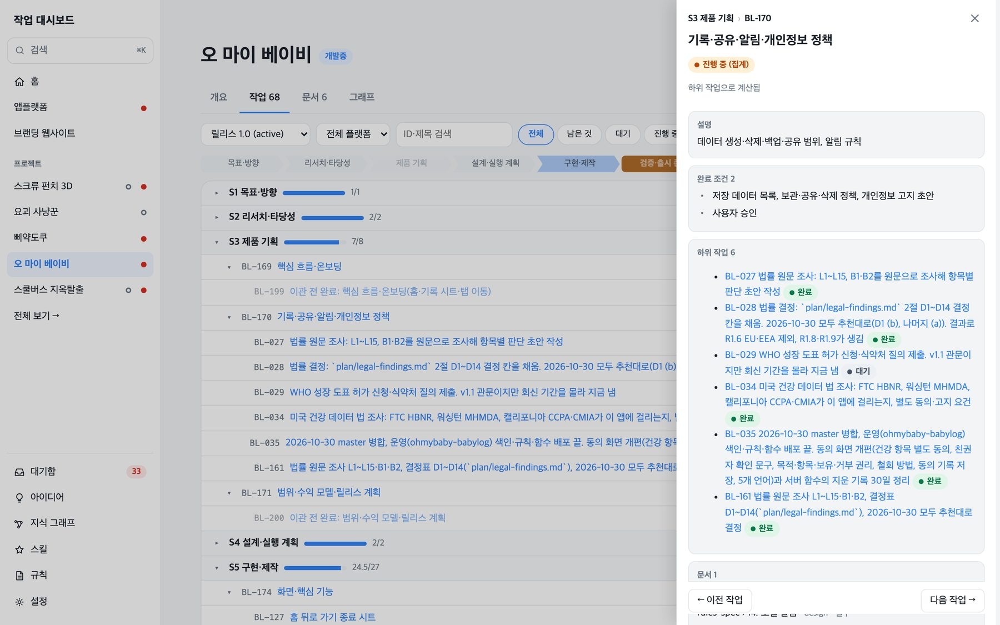

웨이브웍스는 모바일 게임과 앱을 만드는 회사입니다. 지금 다섯 개를 동시에 만들고 있습니다. 버스를 한 대씩 빼내는 퍼즐 스쿨버스 지옥탈출은 Google Play에 출시했고, 나머지는 한 손으로 쓰는 육아 기록 앱 오 마이 베이비, 3D 모형의 나사를 푸는 퍼즐 스크류 펀치 3D, 오행 카드로 요괴를 막는 로그라이크 디펜스 요괴 사냥꾼, 병아리를 한 줄에 하나씩 놓는 논리 퍼즐 삐약도쿠입니다. 코드는 AI 코딩 도구 Claude Code와 함께 짭니다.

앱마다 등록된 작업이 46개에서 176개까지 쌓이면서 "지금 어디까지 했고 다음에 무엇을 하는지"를 적는 방식이 한계에 부딪혔습니다. 11월 5일과 6일에 그 방식을 통째로 바꿨습니다. 마크다운 문서에 손으로 적던 로드맵을 JSON 파일로 옮겼고, 이 파일이 작업 상태의 기준이 되는 원본입니다. 이 글에서는 정본이라고 부릅니다. 그리고 그 파일을 읽어 보여 주는 대시보드를 만들었습니다.

## 기존 관리 체계

문서 두 개가 중심이었습니다. 앱 폴더의 `docs/STATE.md`는 다음 작업 세션이 읽는 인계 문서이고, `docs/ROADMAP.md`는 남은 할 일 목록입니다. AI는 세션을 새로 열 때마다 이전 대화를 기억하지 못합니다. 그래서 작업을 마칠 때 STATE.md에 현재 상태와 다음 할 일을 적고, 다음 세션이 이 문서부터 읽습니다.

오 마이 베이비를 예로 들면 전환 직전 STATE.md는 50줄 12,383바이트, ROADMAP.md는 224줄 39,731바이트였습니다. ROADMAP은 단계마다 표를 두고, 한 줄이 할 일 하나였습니다.

```markdown
| 번호 | 할 일 | 담당 | 선행 | 완료 기준 | 근거 |
| R1.1 | [x] 법률 원문 조사: L1~L15, B1·B2를 원문으로 조사해 항목별 판단 초안 작성 | Claude | - | `plan/legal-findings.md`에 항목마다 출처·판단·방침 반영 여부·사용자 결정 칸 | SHARE-01 8.5.1, BACKUP-01 게시 관문 |
| R1.3 | [ ] WHO 성장 도표 허가 신청·식약처 질의 제출. v1.1 관문이지만 회신 기간을 몰라 지금 냄 | 사용자 | - | 접수 번호를 `plan/GAP-01-gates.md`에 적음 | GAP-01 |
| R10.1 | [ ] 성장 백분위 | Claude | R1.3 WHO 허가 | 기획서 관문 충족 … |
```

쓰는 법은 문서 첫머리에 적혀 있었습니다. 번호 `R<단계>.<순번>`은 순서만 나타내고, 상태는 `[ ]` 남음, `[~]` 일부, `[x]` 끝으로 표시합니다. 한 단계의 줄이 모두 `[x]`가 되면 그 단계를 한 줄 요약으로 접고, 문서는 400줄 안쪽으로 유지합니다. 끝난 일의 증거(콘솔 값, 확인 날짜)는 `plan/release-checklist.md` 같은 다른 문서에 있었습니다.

나머지 앱은 형식이 더 제각각이었습니다. 세 앱은 `plan/progress.md`에 표 형식 진행표를 썼고, 스쿨버스 지옥탈출은 또 다른 형식이라 나중에 사람이 손으로 옮겼습니다.

## 막혔던 곳

- **인계 문서가 계속 커졌습니다.** 인계 문서 크기 상한은 12KB로 잡았는데, 두 앱의 STATE.md는 50KB 안팎까지 불었습니다. 세션을 열 때마다 이 문서를 처음부터 읽어야 합니다.
- **같은 일을 가리키는 번호가 둘이었습니다.** 로드맵 번호 `R1.3`은 순서만 나타내고, 커밋 메시지와 기록 파일은 작업 ID(`GAP-01` 같은)를 씁니다. 두 번호를 잇는 일은 근거 칸에 사람이 적었습니다.
- **`[x]`에 근거가 붙어 있지 않았습니다.** 체크박스는 끝났다는 사실만 기록합니다. 무엇을 보고 끝냈는지는 근거 칸의 문장과 다른 문서에 흩어져 있고, 확인한 뒤 그 코드가 바뀌었는지는 체크박스만으로 알 수 없습니다.
- **선행 관계가 문장이었습니다.** 위 표의 R10.1은 선행 칸에 `R1.3 WHO 허가`라고 적혀 있습니다. 사람은 읽지만 프로그램은 "이 일이 막혔다"를 계산하지 못합니다.
- **화면을 만들려면 형식마다 파서가 필요했습니다.** 오 마이 베이비만 로드맵을 JSON으로 한 방향 변환해 대시보드에 넘기고 있었고, 그 변환본은 정본이 아니었습니다. 표 형식 진행표까지 읽으려면 파서(문서를 읽어 데이터로 바꾸는 프로그램)가 4개 필요했고, 번호를 순서로 매기는 방식은 문서를 고칠 때마다 ID가 흔들렸습니다.

목표는 프로젝트마다 현재 목표, 진행률, 막힌 곳, 결정 대기를 한 화면에서 보는 것이었습니다.

## 정본을 어디에 둘까

세 가지 안을 놓고 11월 5일에 A안으로 정했습니다.

| 안 | 정본 | 고르지 않은 이유 |
|---|---|---|
| A (선택) | `tasks.json`. 인계 문서는 서술만, 로드맵은 생성 뷰 | — |
| B | 인계 문서와 로드맵을 모두 생성 | 인계 규칙과 위키 갱신 절차를 전부 다시 써야 합니다 |
| C | 마크다운을 정본으로 두고 JSON은 파서로 파생 | 파서가 4개 필요합니다. 순서로 매긴 ID가 문서를 고칠 때마다 흔들립니다. 쓸 때는 다시 마크다운으로 바꿔야 합니다 |

`tasks.json`이 정본이고, 사람이 읽는 `ROADMAP.md`는 이 파일에서 프로그램이 만들어 내는 읽기용 문서(생성 뷰)입니다. 서술은 STATE.md와 설계 문서에, 숫자와 상태는 JSON에 나눠 두었습니다. 사람이 쓴 서술을 생성물이 덮어쓰는 일은 하지 않습니다.

### 작업 계층

계층은 5층입니다. 처음에는 1뎁스부터 5뎁스라고 불렀는데, Jira의 Epic·Task·Subtask 같은 업계 관례에 맞춰 이름을 바꿨습니다. 코드의 필드 이름(`stage`, `parent`)은 그대로 두었습니다.

| 층 | 내용 | 진행률 |
|---|---|---|
| 단계(Stage) | `S1`~`S9`. 모든 앱 유형에서 코드·순서·뜻이 고정 | 하위 합산 |
| 에픽(Epic) | 한 단계 안의 큰 작업 덩어리. 템플릿이 깔아 줌 | 하위 합산 |
| 작업(Task) | 만들고 검증하는 일 하나. 진행률 가중치 단위 | 가중치 단위 |
| 세부 작업(Subtask) | 실행 중 생기는 세부 | 영향 없음 |
| 점검 항목(Checklist item) | 최하위 확인 사항 | 영향 없음 |

단계 아홉 개는 목표·방향 설정, 리서치·타당성 검토, 제품 기획, 설계·실행 계획, 구현·제작, 통합 검증·출시 준비, 배포·출시, 운영·마케팅·성장, 회고·자산화입니다. 일의 위치를 가리키는 번호이고, 차례로 통과해야 하는 관문으로 쓰지 않습니다. 앱 유형마다 다른 부분은 에픽 템플릿, 표시 이름, '해당 없음'(`na`) 표시로만 표현합니다. 1.1 업데이트나 Unity 이식처럼 되풀이되는 일은 릴리스(1.0, 1.1 같은 출시 단위)에 묶고, 출시 뒤 끝나지 않는 운영 일은 S8의 상시 에픽에 모아 진행률에서 뺍니다.

위 R1.3은 변환 뒤 이런 작업이 됐습니다. 옛 번호는 `legacy`에 남습니다.

```json
{
  "id": "BL-029",
  "title": "WHO 성장 도표 허가 신청·식약처 질의 제출. v1.1 관문이지만 회신 기간을 몰라 지금 냄",
  "stage": 3,
  "parent": "BL-170",
  "release": "1.0",
  "status": "todo",
  "owner": "user",
  "legacy": [
    { "id": "R1.3", "kind": "roadmap", "source": "docs/legacy/ROADMAP-2026-11-05.md", "line": 37 },
    { "id": "GAP-01", "kind": "work-id", "source": "docs/legacy/ROADMAP-2026-11-05.md", "line": 37 }
  ],
  "done": [{ "text": "접수 번호를 `plan/GAP-01-gates.md`에 적음" }]
}
```

선행 관계는 `dependsOn`에 작업 ID로 적습니다(오 마이 베이비는 작업 176개 중 59개가 씁니다). 위 표의 R10.1처럼 "R1.3 WHO 허가"라는 문장을 적던 자리에 ID가 들어가므로, 순환은 `work check`의 `dependency-cycle`이 막습니다. 외부 회신처럼 사람이 풀어야 하는 대기는 `block` 필드(`kind: external` 같은)에 적고, 이런 작업은 `brief`의 `blocked`에 모입니다.

### 저장하는 것과 계산하는 것

완료와 검증을 서로 다른 층으로 나눴습니다.

| 층 | 값 | 저장 |
|---|---|---|
| 작업 완료 | `status: done`. 과거 사실이라 검증이 낡아도 유지 | 저장 |
| 검증 유효성 | `current` / `stale` / `unknown` / `n/a` | 파생 |
| 관문 통과 | 지금 통과하는지 | 파생 |
| 진행률 | 완료한 작업 기준. 검증 상태와 무관 | 파생 |

진행률은 작업(3층)을 가중치 단위로 잡고 하위에 균등하게 나눕니다. `cancel`과 `na`는 분모에서 빼고, 하위가 아직 정해지지 않은 골격(`plan: tbd`)도 분모에서 뺍니다. 그래서 진행률과 계획 구체화율(확정한 작업 수 / 전체)을 별도 지표로 냅니다.

작업은 릴리스 하나에만 속합니다. 같은 결과를 새 릴리스에서 그대로 쓰면 `inherits`로 참조하고, 요구가 바뀌면 새 작업을 만들어 `supersedes`로 잇고, 이전 릴리스의 검증이 낡았으면 새 검증 작업이 `reverifies`로 연결됩니다. 끝난 릴리스는 `archive/*.json`으로 얼리고 sha256을 `project.json`에 등록합니다. 파일이 바뀌면 `archive-modified` 오류가 납니다.

## 쓰기 규칙과 검증 지문

작업 상태를 고치는 요청은 이런 모양입니다.

```json
{
  "taskId": "BL-029",
  "set": { "status": "doing" },
  "expect": { "status": "todo" },
  "baseHash": "…"
}
```

서버는 파일 락(한 번에 한 쪽만 쓰게 하는 잠금)을 잡고 **최신 파일을 다시 읽습니다.** `baseHash`(요청이 읽은 시점의 파일 해시)가 달라졌다는 이유만으로는 거부하지 않고, `set`에 든 필드마다 `expect`가 최신 값과 같은지 봅니다. 모두 같으면 다른 필드가 바뀌었어도 적용합니다. 하나라도 다르면 요청 전체를 거부하고 최신 값을 돌려줍니다.

- 정상: A가 `status`를 `doing`에서 `done`으로 쓰려는 사이 B가 같은 작업의 `block`만 바꿨습니다. `baseHash`는 다르지만 `expect.status`가 최신과 같아 적용됩니다.
- 거부: B가 먼저 `status`를 `hold`로 바꿨습니다. A의 `expect.status = doing`이 어긋나 거부되고, 최신 값 `hold`가 돌아옵니다.

저장은 임시 파일에 쓴 뒤 이름을 바꾸는 방식이고, 바뀐 필드마다 `changes.jsonl`에 한 줄을 남깁니다(오 마이 베이비는 165줄). 락은 60초가 지나면 걷어내고, 쓸 수 있는 필드는 `status`, `block`, `verification` 세 개뿐입니다. 거부 사유는 `conflict`, `invalid-request`, `archived`, `invalid-file`, `locked`, `write-failed` 여섯 가지입니다. 한 사람이 여러 세션을 동시에 돌리므로, 작업을 잡았다는 표시(`claim`, 4시간)는 참고용으로만 남기고 쓰기를 막지 않습니다. 다른 세션이 잡은 작업이면 결과에 경고만 붙입니다.

### 검증은 지문으로 비교합니다

"확인했다"는 기록에는 확인한 입력의 지문을 함께 저장합니다. 지문은 파일 내용을 해시(sha256)라는 값으로 줄인 것이어서, 내용이 한 글자만 바뀌어도 달라집니다.

| 입력 종류 | 기록하는 값 | 지금과 비교하는 방법 |
|---|---|---|
| `path` | 파일 경로 목록, 정렬한 `경로\0파일sha256` 줄의 sha256 | 작업 트리 파일을 다시 해시. 삭제·추가·내용 변경 모두 stale |
| `doc` | `경로#절 제목`, 절 텍스트의 sha256 | 절을 다시 뽑아 비교. 절이 사라지면 stale |
| `env` | 환경 이름과 값 | `project.json`의 값과 문자열 비교 |

지문은 서버 코드만 계산하고, 요청이 보낸 지문은 버립니다. 입력을 선언하지 않은 `passed`는 유효한지 판정할 수 없어 `unknown`으로 둡니다. 실제 기록은 이런 모양입니다.

```json
{
  "state": "passed",
  "method": "S23 실기기 화면 조작(adb)",
  "note": "2026-11-05 22:17~22:26 1.0(7): 수면 알림 [수면 끝내기] 탭 시 앱이 열려 수면 종료+수정 시트, 알림 사라짐 …",
  "inputs": [{
    "kind": "path",
    "refs": [
      "android/app/src/main/java/com/waveworks/babylog/RunningNotifications.kt",
      "android/app/src/main/java/com/waveworks/babylog/RunningDismiss.kt"
    ]
  }]
}
```

실기기로 확인한 빌드 뒤에 위 파일이 바뀌면 이 검증은 `stale`이 됩니다. 입력을 선언하기 전에는 `git diff <확인 빌드 커밋> HEAD -- <경로>`로 그 뒤에 파일이 바뀌지 않았는지 먼저 대조하고, 바뀌었으면 입력을 선언하지 않습니다.

`work check`는 30종이 넘는 규칙으로 파일을 검사합니다. 중복 ID(`duplicate-id`), 의존성 순환(`dependency-cycle`), 하위가 안 끝났는데 부모만 완료(`parent-done-open-children`), 유효한 검증 없는 완료(`done-without-valid-verification`), 부모와 자식의 릴리스 불일치(`release-mismatch`) 같은 것들입니다. 생성 뷰를 손으로 고치면 종료 코드 1이 납니다. 작업 환경에는 훅도 걸어 두었습니다. `ROADMAP.md` 같은 생성 뷰와 동결한 원문은 수정하려는 순간 차단하고, `tasks.json`을 직접 고치려 하면 경고합니다.

## 이관

**오 마이 베이비**를 먼저 옮겼습니다. 변환 규칙으로 옛 항목을 작업으로 옮기고 옛 번호는 `legacy`에 남겼습니다. 옛 항목 132개가 모두 새 작업에 대응되는지, 면제 처리한 29건이 그대로 남는지 대조했고 `work check`는 오류 0, 경고 47이었습니다. 원문은 `docs/legacy/ROADMAP-2026-11-05.md`로 동결하고 sha256을 `project.json`에 적었습니다.

**표 형식 진행표를 쓰던 세 앱**은 복제본으로 먼저 예행했습니다. 작업이 83개, 78개, 30개로 바뀌었고 오류는 모두 0이었습니다. 되돌리는 경로 두 가지(커밋 전, 커밋 후)를 모두 돌려 원문의 sha256이 같은지 확인했습니다. 리뷰에서 받은 지적으로 원문을 지우기 전에 해시를 한 번 더 확인하는 단계를 넣었습니다. 실제 전환 결과는 작업 104개, 99개, 34개입니다. 전환 직후 진행률이 실제보다 높게 나온 앱이 있었습니다. 남은 계획이 아직 등록되기 전이라 끝난 일만 보였기 때문이고, 남은 계획을 등록해 풀었습니다.

**에픽 템플릿**은 한 번 고쳤습니다. 1판은 템플릿 에픽 121개 가운데 자식 작업이 있는 것이 47개뿐이라 화면이 빈 에픽으로 채워졌고, 에픽마다 어디까지 하면 끝인지가 없었고, 템플릿이 바뀌어도 기존 앱을 옮길 방법이 없었습니다. 2판은 완료 조건을 스키마에 새 필드로 만들지 않고 기존 `done` 필드에 넣었습니다. 빈 에픽은 기본으로 접고 진행률에서 뺍니다. 기존 앱은 옛 에픽을 제자리에서 바꾸는 대신 새 ID로 에픽을 깔고, 자식 작업을 옮긴 뒤 옛 에픽을 지우고 옛 ID는 `legacy`에 남깁니다. 에픽이 갈라지거나 합쳐져도 같은 규칙이 적용되고, 몇 번을 실행해도 결과가 같고, 3판이 나와도 같은 명령으로 옮길 수 있습니다. 앱 5개를 한 명령으로 옮겼고 `check:apps` 19개가 통과했습니다.

## 대시보드

서버는 `node:http` 하나로 짰고, Vite와 React는 `work/dashboard` 폴더에 가둬 루트 `package.json`을 건드리지 않았습니다. 서버가 작업 파일을 감시하다가 바뀌면 화면을 갱신하고, 파일 검증이 실패하면 직전 정상 화면을 유지하면서 위에 노란 띠로 알립니다. 이 글을 쓰려고 화면을 캡처하다가 그 띠를 직접 봤습니다. 먼저 떠 있던 서버가 옛 스키마를 읽고 있어서 `should NOT have additional properties` 오류만 나왔습니다. 새 서버를 다른 포트에 띄워 해결했습니다.



홈은 프로젝트마다 카드 하나입니다. 큰 숫자가 전체 진행률이고, 그 아래 단계 칩 9개에서 현재 단계는 진하게, 병행 중인 단계는 연하게 표시합니다. 맨 아래 한 줄은 진행 중인 작업입니다. 스크린샷은 11월 6일 오후 화면이라 출시 전 작품의 진행률도 그 시점 값입니다. 처음에는 카드에 막대 3개와 에픽 전체와 칩 3개를 넣었더니 "어디까지 왔고 지금 무엇을 하는지"에 바로 답하지 못했습니다. 시안 세 개를 비교해서 큰 전체 퍼센트와 단계 칩 한 줄로 만든 안을 골랐고, 나머지 두 안에서는 테마와 밀도 기준만 가져왔습니다.



프로젝트를 열면 개요 탭이 단계별 진행률(`S1`~`S9`)과 진행 중 작업, 대기 중인 작업, 아직 커밋하지 않은 변경을 보여 줍니다. 대기 두 건은 둘 다 외부 대기입니다. 한 건은 원어민 검수 회신을 기다리는 일이고, 다른 한 건은 출시 뒤로 미룬 Firebase 버전 조사입니다.



작업 탭은 단계 아래 에픽, 에픽 아래 작업이 트리로 펼쳐집니다. 에픽은 하위 작업으로 계산한 상태(「완료 (집계)」)를 보이고, 변환 때 만든 「이관 전 완료」 작업은 따로 표시합니다. 오른쪽 숫자는 그 작업에 연결된 문서 수입니다.



작업을 누르면 오른쪽에 패널이 열립니다. 완료 조건, 하위 작업, 연결된 설계 문서가 한곳에 있고 이전·다음 작업으로 넘어갈 수 있습니다.

편집은 필요한 만큼만 열었습니다. 상태는 끝 작업(하위가 없는 작업)만 고칠 수 있고, 에픽과 단계의 진행률은 하위에서 계산하는 값이라 고칠 수 없습니다. 쓰기는 CLI와 같은 모듈을 거칩니다. 서버가 쓰기 코드를 따로 가지면 락과 충돌 규칙이 두 벌이 되기 때문입니다. 문서 본문은 불러온 시점의 sha256을 함께 보내고, 저장할 때 현재 해시와 다르면 거부한 뒤 최신 본문을 다시 불러옵니다. AI 세션은 락을 쓰지 않아서 이 해시 비교가 유일한 방어입니다. 다른 Origin은 403, `text/plain` 요청은 415, 옛 해시로 다시 저장하면 409로 응답합니다. 256KB가 넘는 문서도 고칠 수 있도록 절 단위 편집을 따로 만들었습니다.

점검하다 사고도 냈습니다. 브라우저로 화면을 확인하다 실제 프로젝트의 상태 버튼을 눌러 오 마이 베이비 작업 하나(`BL-027`)가 바뀌었고, 그 파일을 `HEAD` 상태로 되돌렸습니다. 이후 점검은 상태 버튼을 건드리지 않는 범위로 한정했습니다. 숨겨진 탭이 실시간 연결을 쥐고 있어 브라우저 연결 한도가 바닥나는 문제도 나왔고, 고쳤습니다. 이 사이트(waveworkscorp.github.io)를 위한 화면도 하나 있습니다. 작품, 블로그, 동기화 상태, 방문 통계를 보여 주고, 방문 통계는 쿠키와 브라우저 저장소를 쓰지 않는 Cloudflare Web Analytics에서 읽습니다.

## 결과

11월 6일 오후 기준으로 다섯 앱의 `work check` 결과입니다.

| 앱 | 작업 | 오류 | 경고 |
|---|---|---|---|
| 스쿨버스 지옥탈출 | 67 | 0 | 0 |
| 오 마이 베이비 | 176 | 0 | 15 |
| 스크류 펀치 3D | 113 | 0 | 34 |
| 삐약도쿠 | 108 | 0 | 33 |
| 요괴 사냥꾼 | 46 | 0 | 3 |
| 합계 | 510 | 0 | 85 |

경고는 대부분 "완료로 표시했지만 검증 기록이 없거나 낡았다"는 뜻입니다. 오 마이 베이비는 15건 중 14건이 `done-without-valid-verification`입니다. 앱 네 곳에서 115건이던 경고를 108건으로 줄이면서 남은 건을 모두 앱별 확인 작업에 연결해 두었고, 지금은 85건입니다. 대부분 실기기에서 직접 확인할 항목입니다.

손으로 쓰던 ROADMAP.md(39,731바이트)는 이제 생성 뷰(230줄, 29,097바이트)입니다. 자동 테스트는 대시보드 615개, `work` 도구 604개입니다(11월 6일 인계 기록 기준).

아직 못 한 것도 있습니다.

- 인계 문서는 아직 줄이지 못했습니다. 두 앱의 STATE.md가 각각 50,093바이트와 49,733바이트입니다.
- 대시보드의 일부 화면은 눈으로 확인하지 못했습니다. 900px 이하에서 서랍과 작업 패널의 포커스 이동, 창 높이를 줄였을 때의 하단 고정, 명령 팔레트가 서랍을 닫으며 열릴 때의 포커스 겹침입니다.
- 서버는 코드를 바꾸면 다시 시작해야 반영됩니다.
- 루트 저장소의 `npm run check`에 `work/`가 들어 있지 않아 따로 돌려야 합니다.
- 빈 에픽을 다시 접는 기능이 없습니다.

## 지금 쓰는 방식

작업 세션 하나는 이렇게 흘러갑니다.

```bash
# 세션을 열면 현재 릴리스의 진행률, 진행 중·준비된·막힌 작업을 JSON으로 받음
node work/bin/work.ts brief --dir docs/work

# 계획에 없던 일이 생기면 착수할 때 등록
node work/bin/work.ts add --dir docs/work --parent S5 --title "알림 버튼 재확인" --status doing

# 끝나면 상태 변경. 읽은 값을 expect로 함께 보냄
node work/bin/work.ts set <작업 ID> --dir docs/work --set '{"status":"done"}' --expect '{"status":"doing"}'

# 커밋 전에 생성 뷰를 다시 만들고 검사
node work/bin/work.ts render --dir docs/work
node work/bin/work.ts check --dir docs/work
```

`brief`는 `doing`, `ready`, `blocked`, `standing`, `verification`, `check` 같은 키를 돌려줍니다. 오 마이 베이비에서는 `blocked`에 외부 대기 두 건이, `standing`에 출시 뒤 상시 에픽(문의·오류, 유입·지표, 재방문·기능 개선)이 나옵니다.

- 계획에 없던 요청도 착수할 때 `work add`로 등록합니다. 끝나면 `work set`으로 닫고, 그 작업으로 만든 설계서나 검증 보고는 `work doc-add`로 작업에 연결합니다.
- 커밋 전에는 `work render`와 `work check`(오류 0)를 돌리고, `docs/work`와 생성 뷰를 같은 커밋에 넣습니다.
- STATE.md는 다음 세션에 넘길 서술만 담고, 작업 목록은 복사하지 않고 작업 ID로 참조합니다.
- 새 앱은 `work init`으로 시작합니다. 유형(app, game, web)에 맞는 템플릿 에픽이 S1~S9에 깔립니다.

다음 차례는 눈으로 확인하지 못한 화면입니다. 상태 버튼 사고가 있었으니 실제 프로젝트 데이터는 건드리지 않는 범위에서 봅니다.
